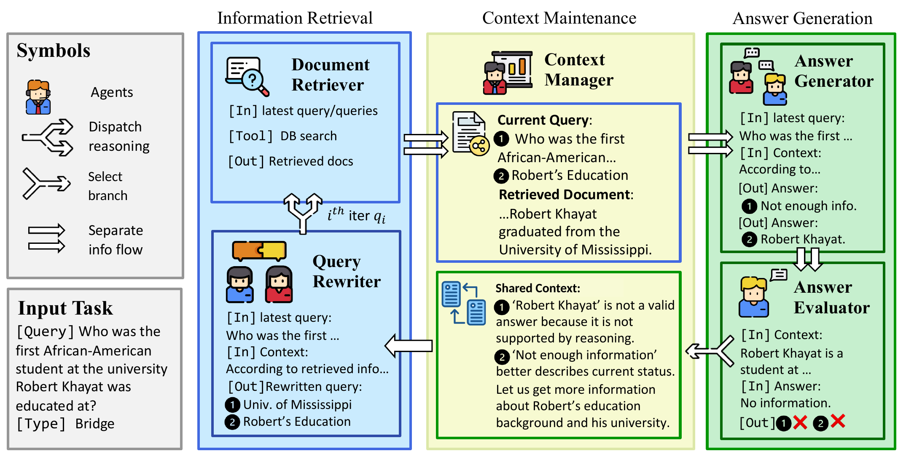
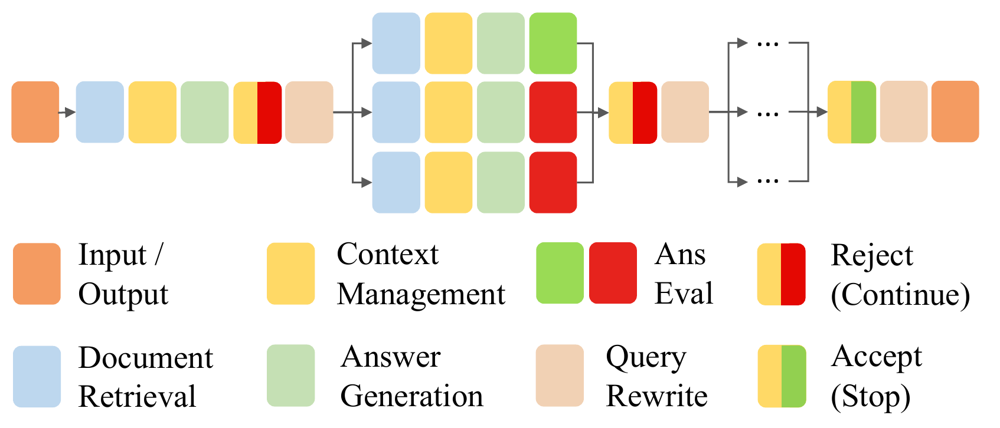

<div align="center">

# SPARC-RAG

### Adaptive Sequential–Parallel Scaling with Context Management for Retrieval-Augmented Generation

Yuxin Yang<sup>1</sup>, Gangda Deng<sup>1</sup>, Ömer Faruk Akgül<sup>1</sup>, Nima Chitsazan<sup>2</sup>, Yash Govilkar<sup>2</sup>,<br>
Akasha Tigalappanavara<sup>2</sup>, Shi-Xiong Zhang<sup>2</sup>, Sambit Sahu<sup>2</sup>, Viktor Prasanna<sup>1</sup>

<sup>1</sup>University of Southern California &nbsp;&nbsp;&nbsp; <sup>2</sup>Capital One

**EMNLP 2026 (Main Conference)**

[](https://aclanthology.org/2026.emnlp-main.1865/)
[](https://huggingface.co/Yang-yuxin)
[](LICENSE)
[](https://www.python.org/)
[](https://pytorch.org/)

<a href="#-overview">Overview</a> •
<a href="#-installation">Installation</a> •
<a href="#-data-preparation">Data</a> •
<a href="#-starting-the-services">Services</a> •
<a href="#-running-sparc-rag">Running</a> •
<a href="#-fine-tuning">Fine-tuning</a> •
<a href="#-citation">Citation</a>

</div>

<p align="center">
  
</p>

**TL;DR.** SPARC-RAG scales retrieval-augmented generation at inference time along two complementary
axes, **depth** (sequential rounds of retrieval and reasoning) and **width** (parallel branches within
a round), and coordinates both around a **unified context management mechanism**: a shared context
state on which specialized agents regulate parallel exploration and sequential stopping. A lightweight
fine-tuning stage with process-level verifiable preferences further improves the efficiency of
sequential scaling and the effectiveness of parallel scaling.

## 🔍 Overview

<p align="center">
  
</p>

SPARC-RAG answers a question in rounds. Each round is carried out by a retriever and four LLM agents
that share one context state:

| Component | Role |
|---|---|
| **Query Rewriter** | Proposes W complementary queries for the next round, each with its own retriever (BM25 or dense) |
| **Document Retriever** | Retrieves the top paragraphs for a query: BM25 (Elasticsearch) or dense (BGE-large + FAISS) |
| **Context Manager** | Updates a branch's note with the new evidence, and selects the branch that continues |
| **Answer Generator** | Answers the question from the note |
| **Answer Evaluator** | Accepts the answer (stop) or rejects it (continue) |

The first round retrieves with the original question on a single path. From the second round on, the
Query Rewriter dispatches **W** branches; each branch retrieves, updates its note, answers and
evaluates its answer. The Context Manager then keeps one branch: if its answer was accepted, the search
stops; otherwise the next round starts from it, up to a depth budget **D**. Preference fine-tuning
(DPO) trains the Query Rewriter towards queries that retrieve more of the evidence and the Answer
Evaluator towards correct stop/continue decisions, so that the depth adapts to each question.

## 📁 Repository structure

```
.
├── exp_helper.py            # Entry point: builds the config, runs predict.py (+ evaluate.py)
├── predict.py               # Runs SPARC-RAG over a question file
├── evaluate.py              # EM / F1 / accuracy and supporting-paragraph metrics
├── count_tokens.py          # Tokens per question of a run, per agent
├── lib.py, logger.py        # Shared helpers; per-run logs and reasoning traces
├── inference/               # The framework: controller, agents, data structures, prompts
├── models/                  # HTTP client of the LLM server
├── llm_server/serve.py      # vLLM-based LLM server
├── retriever_server/        # BM25 (Elasticsearch) and dense (BGE + FAISS) servers, indexing
├── download/                # Dataset download scripts
├── processing_scripts/      # Dataset preprocessing (NQ, Bamboogle, subsampling)
├── metrics/                 # Answer and support metrics
├── configs/                 # Run configurations (backbone × dataset, plus a No-CM ablation)
├── prompts/                 # Prompt templates of the agents
├── training/                # Preference data and asymmetric DPO (see training/README.md)
└── assets/                  # Figures of this README
```

## 🔧 Installation

```bash
git clone https://github.com/Yang-yuxin/SParC-RAG.git
cd SParC-RAG
conda create -n sparcrag python=3.11 -y
conda activate sparcrag
# pick the PyTorch wheel that matches your CUDA version
pip install torch==2.7.1 --index-url https://download.pytorch.org/whl/cu128
pip install -r requirements.txt
```

The versions in `requirements.txt` are the ones this code was tested with (Python 3.11, Linux x86-64,
CUDA 12.x). `vllm` is needed only for the LLM server, and `deepspeed`, `peft`, `trl` and
`tensorboard` only for fine-tuning. BM25 retrieval also needs
[Elasticsearch 7.10.2](https://www.elastic.co/downloads/past-releases/elasticsearch-7-10-2).

## 📚 Data preparation

SPARC-RAG is evaluated on five question-answering benchmarks:

| Dataset | Test questions | Retrieval corpus | Evaluation file (in `processed_data/`) |
|---|---|---|---|
| HotpotQA | 500 | HotpotQA | `hotpotqa/test_subsampled.jsonl` |
| 2WikiMultiHopQA | 500 | 2WikiMultiHopQA | `2wikimultihopqa/test_subsampled.jsonl` |
| MuSiQue | 500 | MuSiQue | `musique/test_subsampled.jsonl` |
| Natural Questions | 500 | DPR Wikipedia passages (`wiki`) | `nq/test_subsampled.jsonl` |
| Bamboogle | 125 | DPR Wikipedia passages (`wiki`) | `bamboogle/test.jsonl` |

The HotpotQA, 2WikiMultiHopQA and MuSiQue test sets are the subsets released with
[IRCoT](https://github.com/StonyBrookNLP/ircot). The scripts below
download and build everything under `raw_data/` and `processed_data/` (override with
`SPARC_RAG_RAW_DATA_ROOT` and `SPARC_RAG_PROCESSED_DATA_ROOT`). Run them from the repository root:

```bash
bash download/processed_data.sh        # IRCoT question files, incl. the test subsets
bash download/raw_data.sh              # corpora and the DPR NQ data (~30 GB of disk)
python processing_scripts/process_nq.py          # ~18 GB of RAM
python processing_scripts/subsample_dataset_and_remap_paras.py nq test 500
python processing_scripts/convert_bamboogle.py   # from Hugging Face: chiayewken/bamboogle

# BM25 indices (Elasticsearch must be running on localhost:9200, see Starting the services)
for c in hotpotqa 2wikimultihopqa musique wiki; do
  python retriever_server/build_index.py $c
done

# Dense indices (BAAI/bge-large-en-v1.5 + FAISS inner-product index)
python retriever_server/preprocess_hotpotqa_corpus.py
python retriever_server/preprocess_2wikimultihopqa_corpus.py
for c in hotpotqa 2wikimultihopqa musique wiki; do
  python retriever_server/build_beir_index.py $c
done
```

Building the `wiki` dense index needs about 2 × 86 GB of RAM and is much faster on a GPU.

<details>
<summary>Development subsets and re-sampling</summary>

<br>

Development subsets can be made with
`python processing_scripts/subsample_dataset_and_remap_paras.py <dataset> dev_diff_size 500`.
Re-drawing the `dev` or `test` samples of HotpotQA, 2WikiMultiHopQA or MuSiQue with this script maps
their paragraphs to the corpus through the retrieval servers listed in `.retriever_address.jsonnet`.

</details>

## 💻 Starting the services

SPARC-RAG talks to three services, all on `localhost` by default. The uvicorn commands below listen
on 127.0.0.1; add `--host 0.0.0.0` only to serve other machines (the servers have no authentication).

**1. Elasticsearch** (port 9200), for BM25:

```bash
cd elasticsearch-7.10.2 && ./bin/elasticsearch
```

**2. Retrieval servers**: BM25 on port 8020 and dense on port 8000.

```bash
uvicorn serve_sparse:app --port 8020 --app-dir retriever_server
uvicorn serve_beir:app   --port 8000 --app-dir retriever_server
```

The dense server loads every corpus in `SPARC_RAG_DENSE_CORPORA` (default
`hotpotqa,2wikimultihopqa,musique,wiki`); all four need about 140 GB of RAM, most of it for `wiki`.
`retriever_server/README.md` shows how to query both servers.

**3. LLM server** (port 8010), backed by vLLM:

```bash
MODEL_NAME=Qwen2.5-7B-Instruct uvicorn serve:app --app-dir llm_server --port 8010
MODEL_NAME=Qwen3-32B           uvicorn serve:app --app-dir llm_server --port 8010
```

`MODEL_NAME` must match the `model_name` of the configuration you run (without the `Qwen/` prefix).
The base models are downloaded from Hugging Face. Qwen3-32B is served with a 16,384-token context (the
other models with 32,768); a longer prompt makes the request fail.
The fine-tuned configurations (`configs/*_dpo_*`) use the model names `Qwen2.5-7B-Instruct-SPARC-DPO`
and `Qwen3-32B-SPARC-DPO`. The fine-tuned checkpoints are on Hugging Face
([7B](https://huggingface.co/Yang-yuxin/Qwen2.5-7B-Instruct-SPARC-DPO),
[32B](https://huggingface.co/Yang-yuxin/Qwen3-32B-SPARC-DPO)); serve one of them, or a checkpoint
you merged yourself (see [Fine-tuning](#-fine-tuning)), under these names with `MODEL_PATH`:

```bash
MODEL_NAME=Qwen2.5-7B-Instruct-SPARC-DPO \
MODEL_PATH=/path/to/merged_checkpoint \
  uvicorn serve:app --app-dir llm_server --port 8010
```

`MODEL_PATH` also serves any other checkpoint under any other name (`CHAT_TEMPLATE=1` sends prompts
through the tokenizer's chat template, `0` completes the raw prompt). `predict.py` measures prompts
with the tokenizer of `model_name` (`inference/prompt_readers.py`); for a name it does not know, set
`MODEL_PATH` in `predict.py`'s environment as well, or use the checkpoint's Hugging Face id as
`model_name`. `TP_SIZE` sets the tensor-parallel size (default: all visible GPUs), and `ENGINE_ARGS`
overrides vLLM engine arguments, e.g. `ENGINE_ARGS='{"gpu_memory_utilization": 0.8}'`.

<details>
<summary>Environment variables</summary>

<br>

| Variable | Default | Used by |
|---|---|---|
| `LLM_SERVER_HOST`, `LLM_SERVER_PORT` | `.llm_server_address.jsonnet` (`http://localhost`, 8010) | `predict.py`, `exp_helper.py`, training drivers (defaults set in the scripts) |
| `ELASTICSEARCH_HOST`, `ELASTICSEARCH_PORT` | `localhost`, 9200 | BM25 server, `retriever_server/build_index.py` |
| `SPARC_RAG_RAW_DATA_ROOT`, `SPARC_RAG_PROCESSED_DATA_ROOT` | `raw_data/`, `processed_data/` | data preparation, dense server |
| `SPARC_RAG_DENSE_CORPORA` | all four corpora | dense server |
| `MODEL_NAME`, `MODEL_PATH`, `CHAT_TEMPLATE`, `TP_SIZE`, `ENGINE_ARGS` | — | LLM server |

</details>

The retrieval endpoints are part of each configuration (`models.document_retriever.retriever_host` and
`retriever_port`) and can be overridden per run with `exp_helper.py --retriever-host`,
`--sparse-retrieval-port` and `--dense-retrieval-port`.

## 🚀 Running SPARC-RAG

`exp_helper.py` builds the run configuration (with any overrides), runs `predict.py` and, with
`--run-evaluate`, `evaluate.py`:

```bash
python exp_helper.py \
    --base-jsonnet configs/qwen2.5_7b_musique.jsonnet \
    --trial musique_7b \
    --eval-path processed_data/musique/test_subsampled.jsonl \
    --run-evaluate -y
```

### Configurations

`configs/` holds one configuration per backbone and dataset, all with width W = 2 (`<dataset>` is
`hotpotqa`, `2wikimultihopqa`, `musique`, `nq` or `bamboogle`):

| Configuration | Backbone | Depth D |
|---|---|---|
| `qwen2.5_7b_<dataset>.jsonnet` | Qwen2.5-7B-Instruct | 6 (fixed) |
| `qwen2.5_7b_dpo_<dataset>.jsonnet` | Qwen2.5-7B-Instruct, fine-tuned | ≤ 8 (adaptive) |
| `qwen3_32b_<dataset>.jsonnet` | Qwen3-32B | 8 (fixed) |
| `qwen3_32b_dpo_<dataset>.jsonnet` | Qwen3-32B, fine-tuned | ≤ 8 (adaptive) |

The base configurations have no Answer Evaluator prompt, so they run at a fixed depth. The fine-tuned
ones need a checkpoint trained as described in [Fine-tuning](#-fine-tuning).
`qwen2.5_7b_dpo_hotpotqa_ablation_no_cm.jsonnet` and `qwen2.5_7b_dpo_musique_ablation_no_cm.jsonnet`
run the fine-tuned 7B model without the Context Manager.

`--set key.path=value` (repeatable) overrides any configuration field. Useful ones:

| Override | Effect |
|---|---|
| `controller.fixed_width=<W>` | W parallel branches per round |
| `controller.fixed_length=<D>` | exactly D rounds (every answer is rejected until then) |
| `controller.max_length=<D>` | at most D rounds, with adaptive stopping (fine-tuned configurations) |
| `models.state_combiner.select_strategy=random` | branch selection: `llm` (default), `random` or `first` |
| `models.document_retriever.fixed_retrieval_type=true` | dense retrieval only |

To run the Query Rewriter without the note, switch it to the `_nocontext` prompt:

```bash
--set models.rewrite.dispatch_prompt_file=prompts/query_rewriter_dispatch_nocontext
```

### Outputs

```
predictions/<trial>/
├── <run_id>/
│   ├── prediction__<stem>.json           # question id → predicted answer
│   ├── prediction__<stem>_all.json       # + retrieved paragraphs, reasoning path, tokens
│   ├── log_graph__<stem>.json            # every step and branch of every question
│   ├── evaluation_metrics__<stem>.json   # EM / F1 / accuracy, supporting-paragraph metrics
│   ├── ground_truth__<stem>.json         # the gold answers evaluate.py scored against
│   ├── config__<stem>.jsonnet            # the configuration that was run
│   ├── all_prompts.json                  # the prompt templates of the run
│   └── process.log                       # run log; ends with [stats] fallback counts
├── predict.log, evaluate.log             # console output (appended across runs)
├── runs.json                             # all runs of the trial
└── run_manifest.latest.json              # the latest run
```

`<stem>` is the name of the evaluation file without its extension (e.g. `test_subsampled`). Until a
run finishes, the two prediction files carry a `_temp` suffix; `predict.py` with the same `--run_id`
resumes from them. The fallbacks counted in `process.log` include unparsable LLM outputs, empty
retrievals and truncated prompts.

The two stages can also be run directly:

```bash
python predict.py --config_path configs/qwen2.5_7b_musique.jsonnet \
    --eval_path processed_data/musique/test_subsampled.jsonl \
    --trial_name musique_7b --run_id run1
python evaluate.py --eval_path processed_data/musique/test_subsampled.jsonl \
    --trial_name musique_7b --run_id run1
```

`python count_tokens.py predictions/<trial>/<run_id>` reports the average number of tokens per
question (prompt plus completion tokens of every LLM call; prompts are counted with tiktoken's
`cl100k_base`), broken down by agent.

## 🎯 Fine-tuning

`training/` contains the fine-tuning pipeline. It generates preference pairs for the Query Rewriter
and the Answer Evaluator from the training splits of HotpotQA, MuSiQue and 2WikiMultiHopQA, trains one
LoRA adapter shared by both agents with an asymmetric DPO loss (wrong-stop pairs weighted by λ), and
merges the adapter into the base model:

```bash
bash training/scripts/gen_query_rewrite_pairs.sh   # 1. Query-Rewriter preference pairs
bash training/scripts/gen_answer_eval_pairs.sh     # 2. Answer-Evaluator preference pairs
bash training/scripts/train_dpo.sh                 # 3. dataset, DPO training (LoRA) and merge
```

The merged model is served with `MODEL_PATH` as shown above. See
[training/README.md](training/README.md) for the details of every step.

## 📝 Citation

If you find SPARC-RAG useful, please cite our paper:

```bibtex
@inproceedings{yang-etal-2026-sparc,
    title = "{SPARC}-{RAG}: Adaptive Sequential{--}Parallel Scaling with Context Management for Retrieval-Augmented Generation",
    author = {Yang, Yuxin  and
      Deng, Gangda  and
      Akg{\"u}l, {\"O}mer Faruk  and
      Chitsazan, Nima  and
      Govilkar, Yash  and
      Tigalappanavara, Akasha  and
      Zhang, Shi-Xiong  and
      Sahu, Sambit  and
      Prasanna, Viktor},
    editor = "Lee, Hung-Yi  and
      Dev, Sunipa  and
      Li, Jessy  and
      Elliott, Desmond",
    booktitle = "Proceedings of the 2026 Conference on Empirical Methods in Natural Language Processing",
    month = oct,
    year = "2026",
    address = "Budapest, Hungary",
    publisher = "Association for Computational Linguistics",
    url = "https://aclanthology.org/2026.emnlp-main.1865/",
    doi = "10.18653/2026.emnlp-main.1865",
    pages = "42480--42508",
    ISBN = "979-8-89176-459-0"
}
```

## 🙏 Acknowledgements

SPARC-RAG builds on [IRCoT](https://github.com/StonyBrookNLP/ircot) and
[Adaptive-RAG](https://github.com/starsuzi/Adaptive-RAG), both released under the Apache License 2.0
(see [NOTICE](NOTICE)). We thank their authors for making their code available.

## 📄 License

This project is released under the [Apache License 2.0](LICENSE).
